# Visa Application Portal

A production web application for a UK visa consultancy. Customers apply online through a guided wizard: a 9-section form, document uploads, appointment preferences and terms acceptance. Consultants run every application from a single admin panel: payment check, document review, correction requests, appointments, PDF/ZIP export and the visa outcome.

The portal is in use with real customers. The interface is in Turkish. Branding and legal texts in this repository are neutral placeholders, and every name, number and document in the screenshots is synthetic.

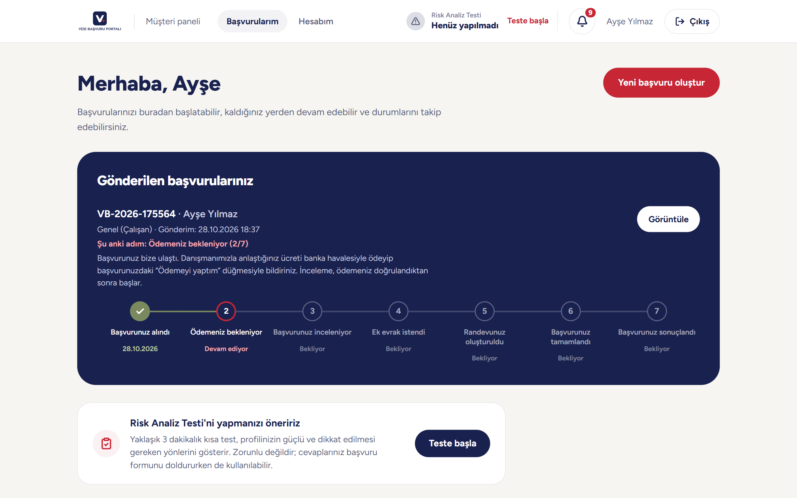

## Highlights

- **The database is the last line of defense.** Every table has row-level security. Privileged writes go only through `SECURITY DEFINER` functions that re-check identity and business rules, and triggers enforce invariants. Every policy has a negative test that runs against the real migrations on an in-memory PostgreSQL.
- **One rule, two implementations, one test.** The application status is derived from what has happened, never picked by hand. The same rule exists in TypeScript for the UI and in SQL where it is enforced, and a test checks that both give the same answer. Document requirements per application-type combination work the same way.
- **Files never pass through the app server.** The browser uploads to a single-use signed URL; the server then verifies the real content (magic bytes and size). The "download all documents" ZIP is streamed to stay under the 4.5 MB serverless response limit.
- **The paper form, filled in.** Answers are laid out on the consultancy's original PDF form. Text shrinks to fit, and anything that still does not fit moves to an appendix page instead of being cut off.
- **Two-factor authentication for staff, enforced twice.** Staff permissions exist only in sessions that passed TOTP (`aal2`), checked in the app and in the database. Lost authenticators are handled with one-time recovery codes stored as hashes.
- **500+ automated tests** for business rules, PDF and ZIP output, and database security.

## Screenshots

**Customer panel**

| | |
| :-: | :-: |
| 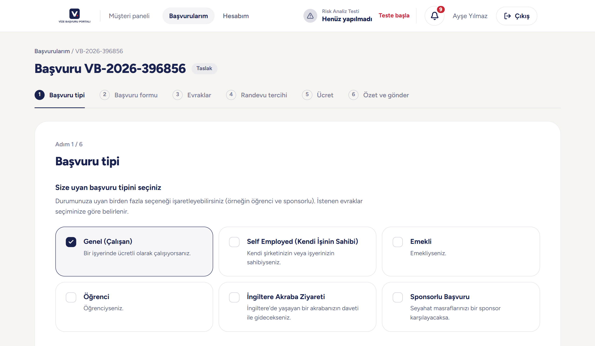<br>Wizard: application type (types can be combined) | 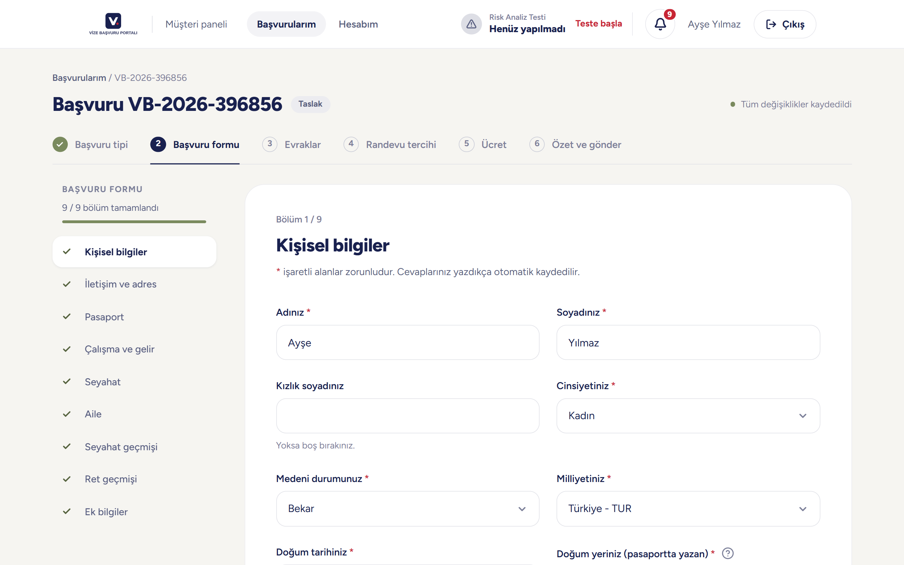<br>Wizard: 9-section form, saved as you type |
| 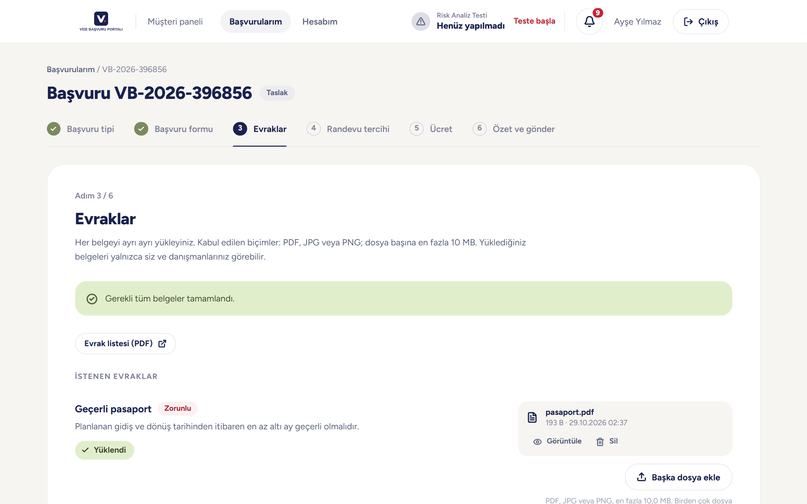<br>Wizard: documents, with the checklist as a PDF | 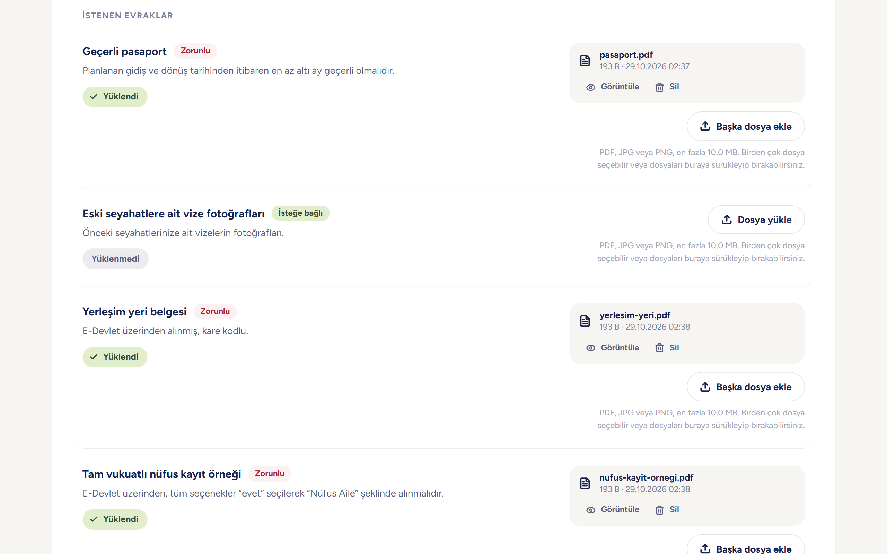<br>Required and optional documents, multi-file and drag-and-drop upload |
| 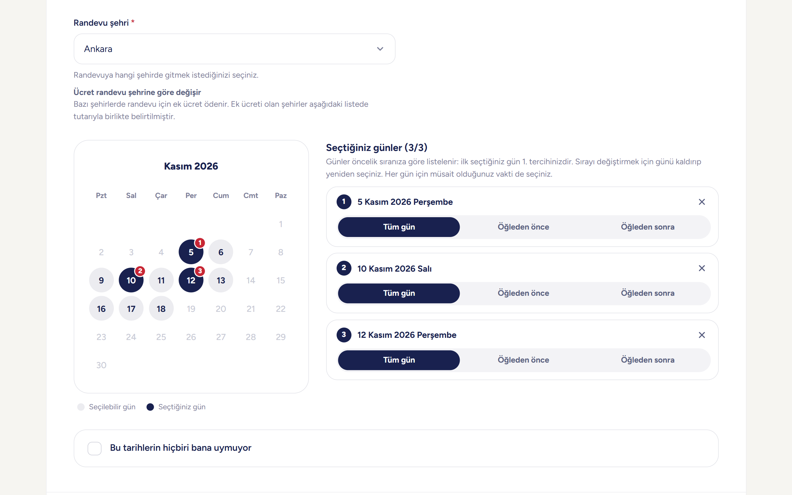<br>Wizard: appointment city and up to three preferred days | 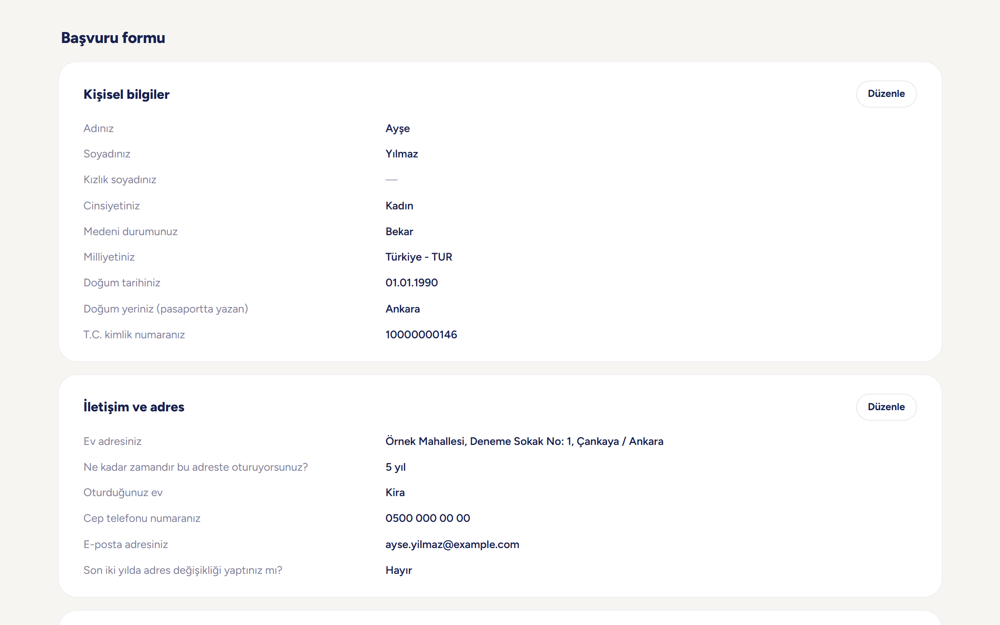<br>Wizard: summary of every answer |
| 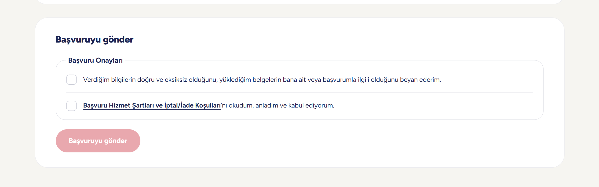<br>Submission requires two confirmations | 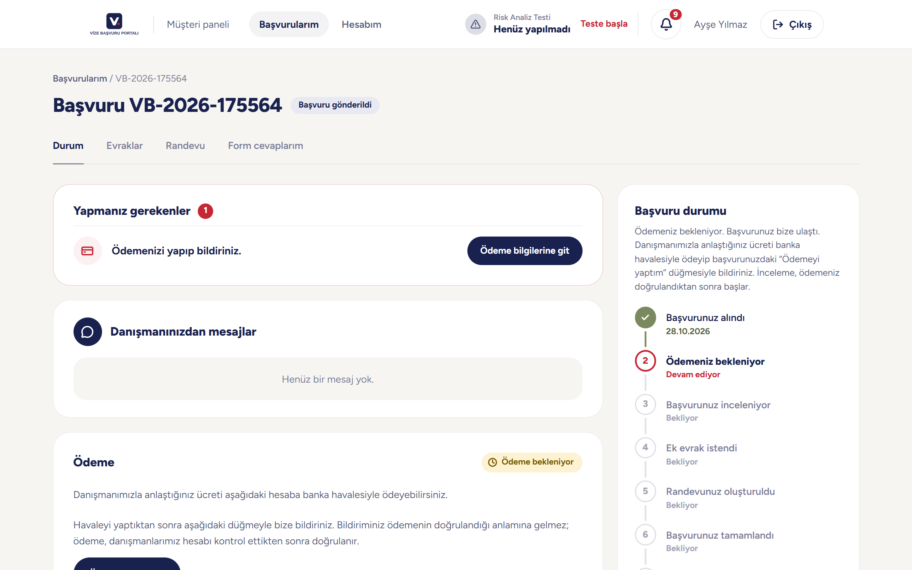<br>Status page: what the customer needs to do next |

**Admin panel**

| | |
| :-: | :-: |
| 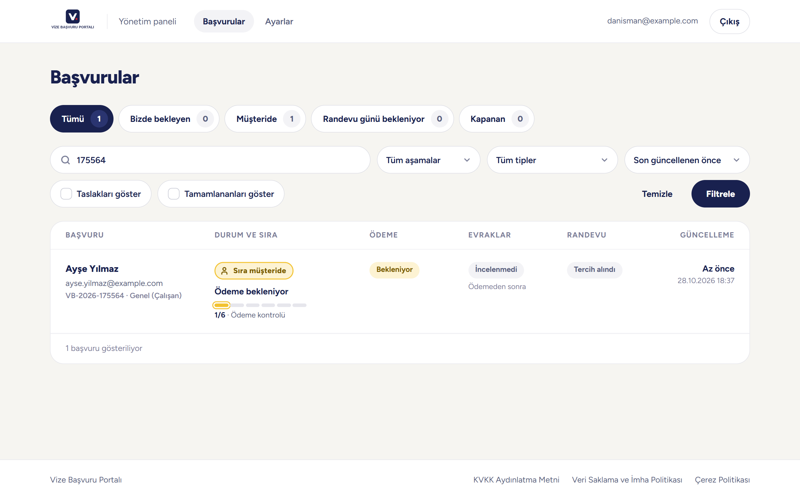<br>Application list with tabs, filters and a stage bar | 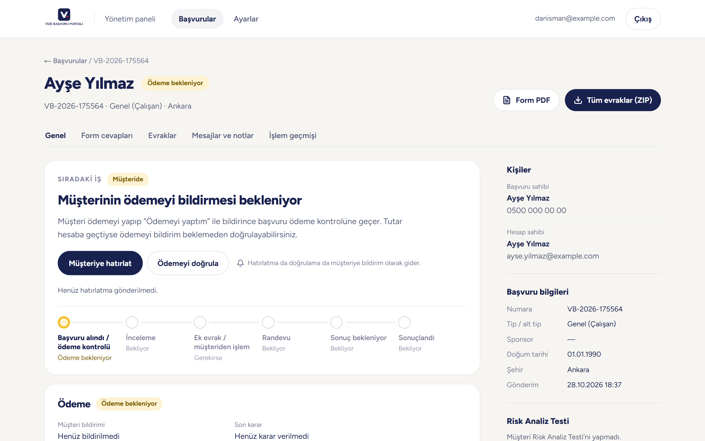<br>Application detail: next task, people, application data |
| 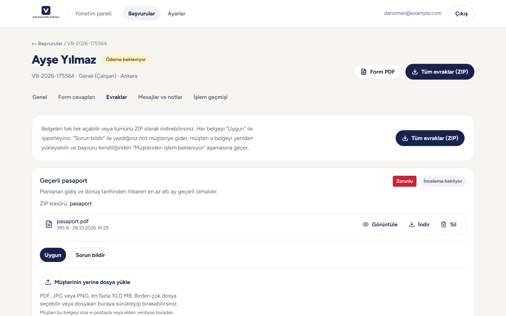<br>Per-document review, PDF form and ZIP export | 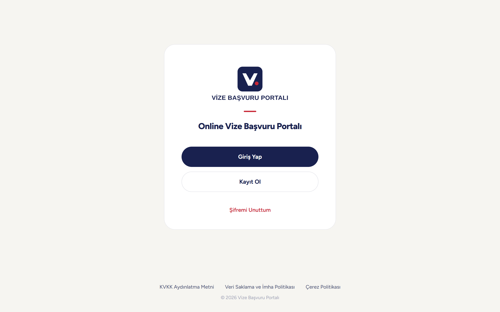<br>Sign-in |

## Features

**Customer panel**

- Sign-up with e-mail verification, CAPTCHA and "remember me" sessions
- Application wizard: application type, a 9-section form with conditional fields and date rules, documents, appointment preferences, fee step, summary, and submission with terms acceptance
- Document checklist generated from the selected application types, also downloadable as a PDF
- Uploads go straight to private storage via signed URLs, several files at once or by drag and drop; extra documents can be sent after submission up to a configurable limit
- Status page with a 7-step timeline, a "what you need to do" list, messages from the consultant and an appointment card (map link, appointment letter)
- In-app notifications mirrored to e-mail, each linking to the relevant screen
- Risk assessment questionnaire whose answers can prefill the application form

**Admin panel**

- Application list with tabs ("waiting on us", "waiting on the customer", …), filters, a stage bar and markers for form-edit requests and unseen extra documents
- Application detail: next-task card, payment review, per-document review ("approved" / "report a problem"), correction requests, customer tasks, internal notes and a full audit history
- Filled-in application form as a PDF, and all documents as a ZIP sorted into the consultancy's folder structure
- Appointment scheduling with an optional appointment letter; visa outcome with an attached result
- Settings: cities, appointment locations, document catalogue, document rules per application-type combination, ZIP folders (drag to reorder), payment details, retention period, extra-document limit
- Staff management for admins: invitations, access, two-factor reset, admin role, account deletion; admins can also delete applications permanently

## Tech stack

| Area | Choice |
| --- | --- |
| Framework | Next.js 16 (App Router, Server Actions, Cache Components), React 19, TypeScript |
| Styling | Tailwind CSS v4, design tokens in `src/app/globals.css` |
| Backend | Supabase: PostgreSQL, Auth (TOTP MFA), Storage (private bucket) |
| Validation | Zod schemas and explicit checks; every server action argument is treated as untrusted |
| Documents | pdf-lib + fontkit for the form and checklist PDFs, fflate for the streamed ZIP |
| E-mail | Nodemailer over SMTP, queued in the database |
| Testing | Vitest, PGlite (in-memory PostgreSQL running the real migrations), pdf.js for PDF assertions |
| Hosting | Vercel (London region, next to the database), Cloudflare Turnstile |

## Architecture

- **Business rules are pure functions** in `src/features/*`: submission checks, status flow, upload authorization, document rules, appointment windows, risk scoring. They are unit-tested. Pages and components only render; server actions validate input, check the session and call these rules.
- **Authorization happens on the server, every time.** Every page, server action and route handler checks the session and role through `src/server/auth.ts`; hiding a button is never treated as security.
- **Everything is audited.** Reviews, status changes, file views and downloads, exports and deletions are written to an audit log together with the actor.
- **Schema changes are plain SQL migrations** (27 so far). A read-only verification query checks a real installation, and a test keeps it in sync with the migrations.

## Security and privacy

- Staff permissions only in sessions that passed two-factor authentication, with one-time recovery codes
- Staff management and deletion restricted to admins, in the app and in the database
- National ID and passport numbers never appear in URLs, logs, error messages or audit entries
- Private storage bucket, short-lived signed URLs, a strict Content Security Policy and security headers
- Configurable retention: closed applications and their files are deleted automatically after the set period
- Only strictly necessary cookies

## Testing

```bash
npm test            # 500+ tests: rules, PDF and ZIP output, database security on PGlite
npm run typecheck
npm run lint
npm run build
```

The database suites apply every migration in `supabase/migrations` to an in-memory PostgreSQL and test row-level security, service functions and triggers as different roles: anonymous, customer, staff without MFA, staff, admin and service.

## Running locally

1. Install dependencies: `npm install`
2. Copy `.env.example` to `.env.local` and fill in the Supabase URL and keys.
3. Create a Supabase project and run `supabase/setup/full-installation.sql` once in the SQL editor (or the files in `supabase/migrations` in order). Then run `supabase/checks/verify-installation.sql`; every row should read `OK`.
4. Paste the e-mail templates from `supabase/email-templates` into Supabase Auth.
5. Run `npm run dev`, then create the first admin account: `npm run staff:create -- --email … --first-name … --last-name …`

## Project structure

```
src/app/            routes: public pages, /panel (customer), /admin (admin), API routes
src/components/     UI: customer wizard and dashboard, admin panel, shared parts
src/features/       business rules as pure functions (tested)
src/server/         server actions, data loaders, auth, e-mail, export
supabase/           migrations, verification query, e-mail templates, scheduled jobs
tests/              unit, PDF/ZIP, database (PGlite) and optional Supabase integration tests
```

## License

Published as a portfolio project. All rights reserved.
